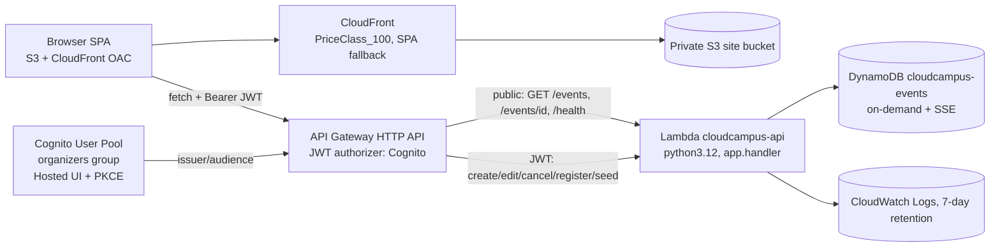

# CloudCampus architecture

## 1. Shape



Everything is regional in `ap-south-1` except CloudFront, which is a global
service by design. No EC2, RDS, NAT gateway, ALB, EKS or OpenSearch.

## 2. Data model

One table, `cloudcampus-events`, holds both entities.

### Event item

| Attribute | Value |
|---|---|
| `PK` | `EVENT#{id}` |
| `SK` | `EVENT#{id}` |
| `GSI1PK` / `GSI1SK` | `STATUS#{status}` / `DATE#{date}#{id}` |
| `GSI3PK` / `GSI3SK` | `ORGANIZER#{organizerId}` / `DATE#{date}#{id}` |

Plus `id`, `title`, `description`, `category`, `date`, `time`, `location`,
`capacity`, `deadline`, `organizerId`, `organizerName`, `registrations`,
`status`, `createdAt`, `updatedAt`.

### Registration item

| Attribute | Value |
|---|---|
| `PK` | `EVENT#{eventId}` |
| `SK` | `USER#{userId}` |
| `GSI2PK` / `GSI2SK` | `USER#{userId}` / `EVENT#{eventId}` |

Plus `eventId`, `userId`, `status` (`registered` / `cancelled`), `registeredAt`,
and `cancelledAt` on cancellation.

### Access patterns

| Need | Access |
|---|---|
| Published events, date order | `Query GSI1 WHERE GSI1PK = 'STATUS#published'` |
| Draft / cancelled events | same query with a different `GSI1PK` |
| Event detail | `GetItem PK=SK=EVENT#{id}` |
| My registrations | `Query GSI2 WHERE GSI2PK = 'USER#{sub}'`, then hydrate each event |
| Organizer dashboard | `Query GSI3 WHERE GSI3PK = 'ORGANIZER#{sub}'` |
| Attendee list | `Query PK = 'EVENT#{id}'` (SK prefix `USER#`) |

`GSI3` exists so an organizer can see their own events in every status. Without
it, draft and cancelled events are unreachable through the API and the
dashboard would have to scan every status partition.

### Deadline representation

`deadline` is always stored as `YYYY-MM-DDTHH:MM:SS+00:00`. The DynamoDB
condition `deadline > :now` is a *string* comparison, so a canonical, fixed
width, UTC form is what makes that comparison chronologically correct. Inputs
are normalised on write (`canonical_deadline`), which also makes
`2026-11-14T23:30:00Z` and `2026-11-15T05:00:00+05:30` behave identically.

## 3. Concurrency: why registration is a two-operation transaction

Registration must atomically check capacity, event status and deadline, create
the registration row, and increment a denormalised counter.

DynamoDB **forbids two operations on the same item inside one transaction**.
The original code sent four operations across two items (two
`ConditionCheck`s plus a `Put` on the registration item and an `Update` on the
event item), which DynamoDB rejects outright. It also bound an
`ExpressionAttributeValues` entry (`:c`) that no expression referenced, which is
a second `ValidationException`.

The shipped design uses exactly two operations on two distinct items:

```text
TransactItems:
  [0] Put   registration item
           ConditionExpression: attribute_not_exists(PK) OR #s = :cancelled
  [1] Update event item
           UpdateExpression:    SET #r = #r + :one, #u = :u
           ConditionExpression: #s = :published AND #r < #c AND #d > :now
```

- The `Update` both validates and increments, so the capacity check and the
  counter increment cannot be separated by a concurrent writer.
- The `Put` condition rejects an existing *active* registration while still
  allowing a user to re-register after cancelling (`status = 'cancelled'`).
- Either both happen or neither does, so a registration row never exists
  without its seat, and a seat is never taken without a row.

Unregister mirrors this with an `Update` on the registration row (guarded by
`status = 'registered'`) plus a guarded decrement on the event item
(`registrations > 0`, so the counter can never go negative).

`tests/fakes.py` enforces both DynamoDB rules, and
`tests/test_backend.py::TransactionShapeTests` pins the shape so the bug
cannot come back.

## 4. Authentication and authorisation

- API Gateway HTTP API carries a **JWT authorizer** pointed at the Cognito user
  pool. Unauthenticated calls to protected routes are rejected by API Gateway
  with `401` before the Lambda runs.
- Public routes: `GET /health`, `GET /events`, `GET /events/{id}`.
- The `organizers` group arrives in the `cognito:groups` claim. It is the only
  organiser signal, and the frontend checks are display-only.
- Ownership (`organizerId == sub`) is re-checked in the backend on every
  mutation and on the attendee list, then enforced again by the DynamoDB
  `ConditionExpression` on `organizerId`, so a forged or stale token cannot
  mutate somebody else's event.
- Password policy: minimum 8 characters with upper, lower and numeric
  characters. Email is auto-verified. No MFA (out of scope for this demo).
- The SPA uses authorization code + PKCE, stores tokens in `localStorage`, and
  now refreshes the access token proactively and after a `401`, so the session
  survives the one-hour token lifetime.

## 5. API surface

| Method | Route | Auth |
|---|---|---|
| GET | `/health` | public |
| GET | `/events` | public (`?status=`, `?category=`, `?search=`) |
| GET | `/events/{id}` | public |
| POST | `/events` | organizer |
| PATCH | `/events/{id}` | organizer, owner |
| POST | `/events/{id}/cancel` | organizer, owner |
| POST | `/events/{id}/register` | any signed-in user |
| POST | `/events/{id}/unregister` | any signed-in user |
| GET | `/me/registrations` | any signed-in user |
| GET | `/me/events` | any signed-in user (organizer view) |
| GET | `/events/{id}/attendees` | organizer, owner |
| POST | `/seed` | organizer |

Every response is JSON: `{"success": true, "data": ...}` or
`{"success": false, "error": "...", "message": "..."}`. CORS is restricted to
the deployed CloudFront origin (`FRONTEND_ORIGIN`), with a permissive first
pass so the frontend can be built and uploaded before the origin exists.

## 6. Frontend

- React 19 + TypeScript + Vite, no AWS SDK and no Amplify. Cognito is used
  directly against the hosted UI endpoints.
- `auth.ts`: PKCE pair generation, hosted UI login/signup URLs, code exchange,
  refresh-token flow, hosted UI logout URL, JWT decoding for display.
- `app-shell.tsx`: single `call()` helper that attaches the bearer token,
  refreshes proactively (60 s before expiry) and retries once on `401`.
- `views-events.tsx`: discover list with search, category filter, loading,
  error, empty and full states; event detail with seats and deadline.
- `views-manage.tsx`: my registrations with cancel; organizer dashboard with
  create form, own-event list, attendee viewer and sample-data loader.

## 7. Deliberate non-goals

EC2, RDS, NAT, ALB, EKS, OpenSearch, PITR/backups, WAF, custom certificates,
SES email confirmations, EventBridge reminders, Lambda@Edge, StackSets,
cross-region anything, IAM user/key creation. The core is shippable and
verifiable without them.

## 8. Repository contents

Only what is needed to build, test, deploy and run the application is
committed. Everything else is regenerated by the tooling and is ignored via
`.gitignore`:

| Committed | Purpose |
|---|---|
| `backend/`, `frontend/`, `infra/`, `scripts/`, `tests/` | Application and infrastructure source |
| `docs/`, `README.md`, `frontend/README.md` | Documentation |
| `frontend/.env.production` | Public identifiers so a fresh clone can talk to the deployed backend |
| `.gitignore`, `LICENSE` | Repository metadata |

| Generated (not committed) | Produced by |
|---|---|
| `frontend/dist/`, `frontend/node_modules/` | `npm run build` / `npm install` |
| `__pycache__/`, `.pytest_cache/` | running the tests |
| `backend.zip` | `scripts/deploy.ps1` |
| `deployment-outputs.json` | `scripts/deploy.ps1` |

Report/document generation artefacts (screenshots, `*.docx`, `*.pdf`, `reports/`)
are intentionally not part of the repository.